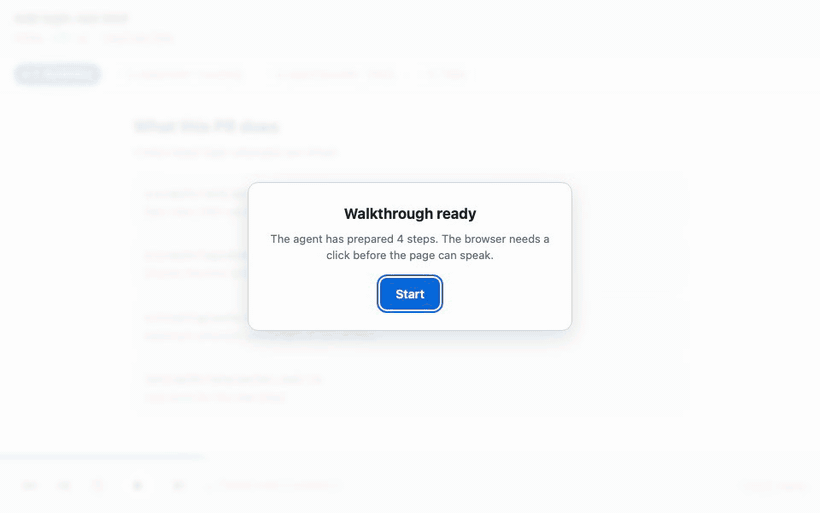

# PRWalk

**Have your coding agent walk you through a pull request, out loud.**

Reading a big diff cold is slow. A five-minute call with the author is fast: they tell you what the change is for, show you the three places that matter, and answer your questions as you go. PRWalk gives you that call with your agent as the author.



Ask your agent for a walkthrough and a page opens next to your chat. A voice explains the change while the code it is talking about lights up and the rest fades back. Pause whenever you like and ask a question in the chat: the agent answers out loud, shows you the code behind its answer, and the walkthrough picks up where you left it.

## Why you will like it

- **It explains, it does not recite.** A summary first, then the files in the order that makes them understandable, then what the tests cover and what they do not. Not the order of the diff.
- **You see the map.** The files of the PR are in a tree on the left, and the agent points at each zone of the change while it explains it.
- **You stay in control.** Play, pause, step back, jump to any step, replay the last one. Space, ← and → do the same.
- **Interrupt like on a real call.** "Why not a transaction here?", "skip the tests", "go deeper from now on": say it in your agent's chat and the walkthrough adapts.
- **As long as you want it.** A two-minute overview, the key files, or every hunk.
- **It adapts to you.** It starts with the overview and goes into detail where you ask. Your preferences live in a file that you or your agent edit.
- **In your language.** The narration follows the language you speak to your agent.
- **A voice you can stand.** It starts with your browser's voices, installs a natural-sounding local one with one command, or uses any engine you plug in.
- **Private.** It runs on your machine. Your code and the narration stay there.
- **Works with your agent.** Claude Code, or anything else that can run a command. No MCP server, no account, no API key.

## Install

Requires Node.js 22 or later and git. GitHub pull requests also need the [GitHub CLI](https://cli.github.com/) (`gh`), signed in.

```sh
npm install -g https://github.com/gabimig/prwalk/releases/latest/download/prwalk.tgz
prwalk skill install
```

The second command adds the PRWalk skill to Claude Code. For another agent, use `prwalk skill install --dir <its skills folder>`, or tell it to run `prwalk skill` and follow the guide it prints.

The easy way: give your agent this page and say **"install this"**.

> **If you are the agent installing it:** the skill is not loaded in this conversation yet, and it does not need to be. When the user asks for a walkthrough, run `prwalk skill` and follow the guide.

## Use it

Inside a repository, ask your agent:

- "Walk me through PR 482."
- "Explain my local changes out loud, in full detail."
- "Hazme un walkthrough completo de esta PR."

The first time, it offers you a choice of voice. Then press Start in the page and listen. To interrupt, pause and type your question in the chat.

## Voices

PRWalk speaks with your browser's voices out of the box. For a much better one that still runs on your machine, in English and Spanish:

```sh
prwalk voice install kokoro
```

You can also plug in any other engine, local or in the cloud, with a small adapter your agent can write for you. See [Voices](docs/voices.md).

## How it works

Your agent reads the diff and writes a script: steps, each one a range of code or a summary card, with the sentences to say. A small local program serves the page, which plays the script and reports back where you are, so the agent always knows what "this line" means when you ask. That is all there is: a command-line tool, a web page, and a short guide that teaches the agent how to present a change well.

## More

- [Commands, viewer controls and settings](docs/commands.md), including how to try it without an agent, privacy details, how to uninstall, and known limitations
- [Voices](docs/voices.md): the local voice, its licences, and writing your own adapter
- [Working on PRWalk](docs/development.md)
- [Security policy](SECURITY.md)

## Licence

Copyright (C) 2026 Gabriel Miguez Miguez. PRWalk is free software under the GNU General Public License, version 3 or (at your option) any later version; the full text is in [LICENSE](LICENSE). It comes with no warranty. The local voices that `prwalk voice install` installs are not part of PRWalk and have their own licences, which `prwalk voice list` shows.
